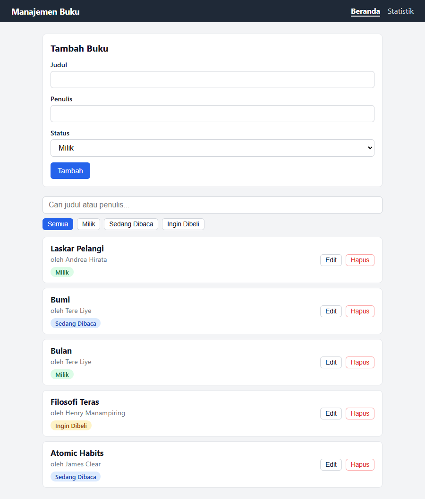
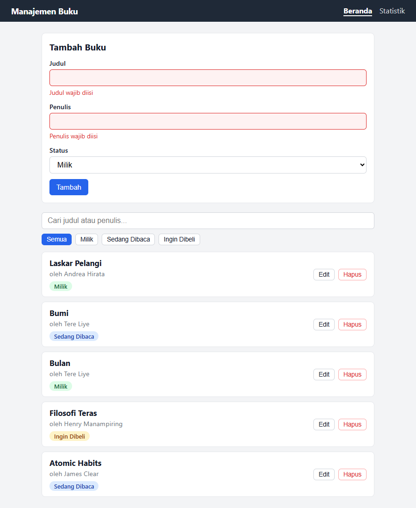
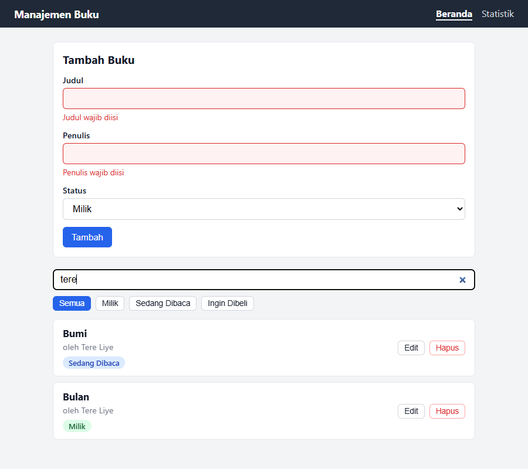
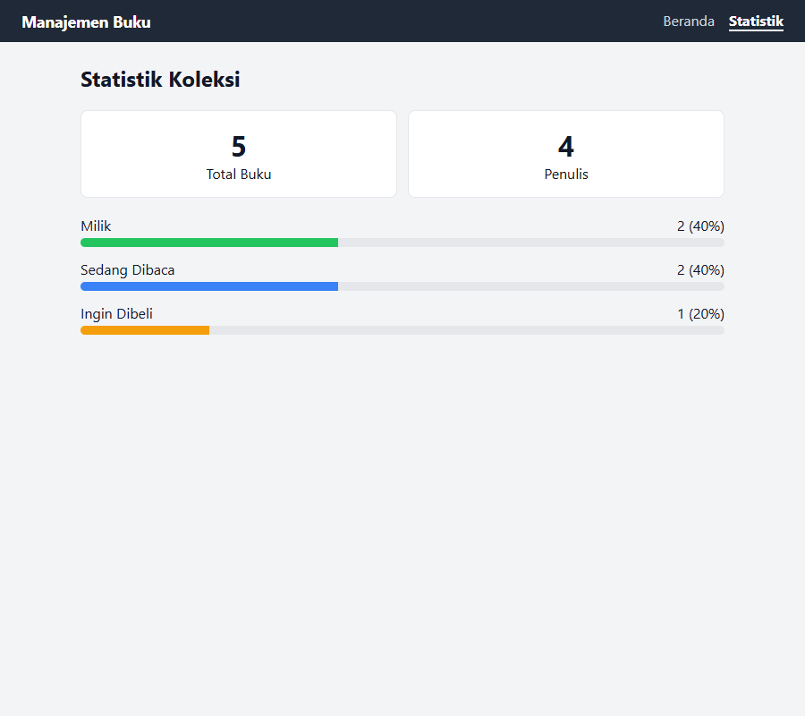
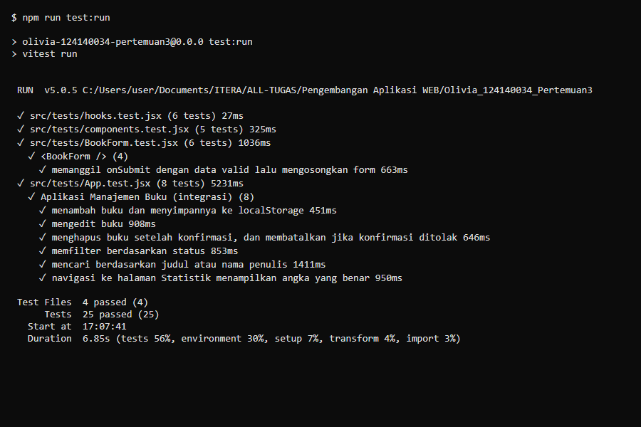

# Manajemen Buku Pribadi

Tugas Praktikum PAW Pertemuan 3 — Olivia (124140034).

## Deskripsi

Aplikasi web sederhana untuk mencatat buku pribadi. Setiap buku memiliki
**judul**, **penulis**, dan **status**:

- **Milik** — buku yang sudah dimiliki
- **Sedang Dibaca** — buku yang sedang dibaca
- **Ingin Dibeli** — buku yang ingin dibeli

Fitur:

- Tambah, edit, dan hapus buku
- Filter berdasarkan status
- Pencarian berdasarkan judul atau nama penulis
- Halaman statistik koleksi (total, penulis unik, jumlah & persentase per status)
- Data tersimpan permanen di `localStorage`
- Validasi form: judul & penulis wajib diisi, dengan umpan balik visual (border merah + pesan error)

## Instalasi & Menjalankan

Butuh Node.js (disarankan versi LTS terbaru).

```bash
npm install          # pasang dependensi
npm run dev          # jalankan server pengembangan (http://localhost:5173)
npm run test:run     # jalankan seluruh unit test sekali
npm test             # jalankan test dalam mode watch
npm run build        # build produksi ke folder dist/
npm run preview      # pratinjau hasil build
npm run lint         # cek kualitas kode
```

### Membuka dengan Live Server (Go Live) di VS Code

Live Server hanya bisa menyajikan hasil build, bukan source `src/`:

1. `npm install` lalu `npm run build` (menghasilkan folder `dist/`)
2. Klik **Go Live** di status bar VS Code. `.vscode/settings.json` sudah mengatur
   `liveServer.settings.root` ke `/dist`.
3. Setiap mengubah kode, jalankan `npm run build` lagi lalu refresh browser.

Aplikasi memakai `HashRouter` (URL seperti `/#/stats`) dan `base: './'` agar
berjalan di server statis tanpa konfigurasi tambahan. Untuk pengembangan sehari-hari,
`npm run dev` tetap lebih nyaman (hot reload).

## Screenshot

**Beranda** (form tambah, pencarian, filter status, daftar buku)



**Validasi form** (kolom kosong diberi border merah + pesan error)



**Pencarian** (kata kunci "tere")



**Statistik**



## Laporan Testing

Hasil `npm run test:run` (25 test lulus):



Keluaran teks lengkap: [`docs/hasil-test.txt`](docs/hasil-test.txt).

## Struktur Folder

```
src/
├── components/
│   ├── BookForm/       form tambah/edit + validasi
│   ├── BookList/       daftar buku (+ pesan kosong)
│   ├── BookItem/       satu baris buku
│   ├── BookFilter/     kotak pencarian + tombol filter status
│   ├── StatusBadge/    label status berwarna
│   └── Navbar/         navigasi antar halaman
├── pages/
│   ├── Home/           form + filter + daftar
│   ├── Stats/          statistik koleksi
│   └── NotFound/       halaman 404
├── hooks/
│   ├── useLocalStorage.js   state tersinkron dengan localStorage
│   ├── useBookStats.js      hitung statistik buku
│   └── useBooks.js          akses BookContext
├── context/
│   ├── BookContext.jsx      BookProvider (state global + CRUD + filter)
│   └── contextObject.js     objek context
├── constants/          daftar status & PropTypes shape buku
├── utils/              fungsi validasi
├── tests/              unit & integration test
└── App.jsx             definisi rute
```

## Fitur React yang Digunakan

| Konsep | Penerapan |
| --- | --- |
| `useState` | State form, nilai input, error, filter, pencarian, buku yang sedang diedit |
| `useEffect` | Menyimpan data ke `localStorage` setiap berubah (`useLocalStorage`) |
| `useMemo` / `useCallback` | Hasil filter, statistik, dan value context agar tidak dihitung ulang tanpa perlu |
| Context API | `BookProvider` menyediakan daftar buku, fungsi CRUD, filter, dan pencarian ke semua halaman |
| React Router | `HashRouter`, `Routes`/`Route`, `NavLink` untuk halaman Beranda, Statistik, dan 404 |
| Custom hooks | `useLocalStorage`, `useBookStats`, `useBooks` |
| Reusable components | `BookForm`, `BookList`, `BookItem`, `BookFilter`, `StatusBadge`, `Navbar` |
| PropTypes | Semua komponen (dan `BookProvider`) mendefinisikan `propTypes`; bentuk objek buku dipakai ulang lewat `bookShape` |
| Error handling form | `validateBook` memeriksa kolom wajib; error ditampilkan dengan `role="alert"`, `aria-invalid`, dan style merah |
| `key` untuk reset state | `BookForm` di-remount lewat `key` saat berpindah mode tambah/edit |

## Testing

Menggunakan **Vitest** + **React Testing Library** (lingkungan `jsdom`). Total 25 test
di folder `src/tests/`:

- `hooks.test.jsx` — `useLocalStorage` dan `useBookStats`
- `BookForm.test.jsx` — validasi dan perilaku form (tambah & edit)
- `components.test.jsx` — `BookList` dan `BookFilter`
- `App.test.jsx` — alur lengkap: tambah, edit, hapus, filter, cari, persistensi, statistik, 404

Jalankan dengan `npm run test:run`.
