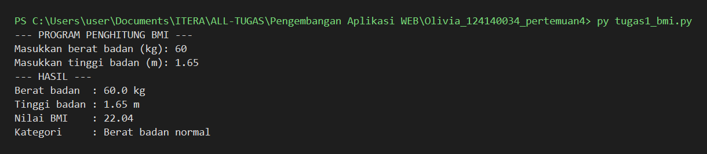
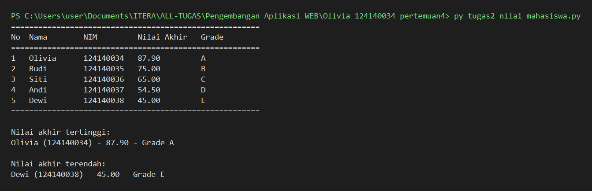
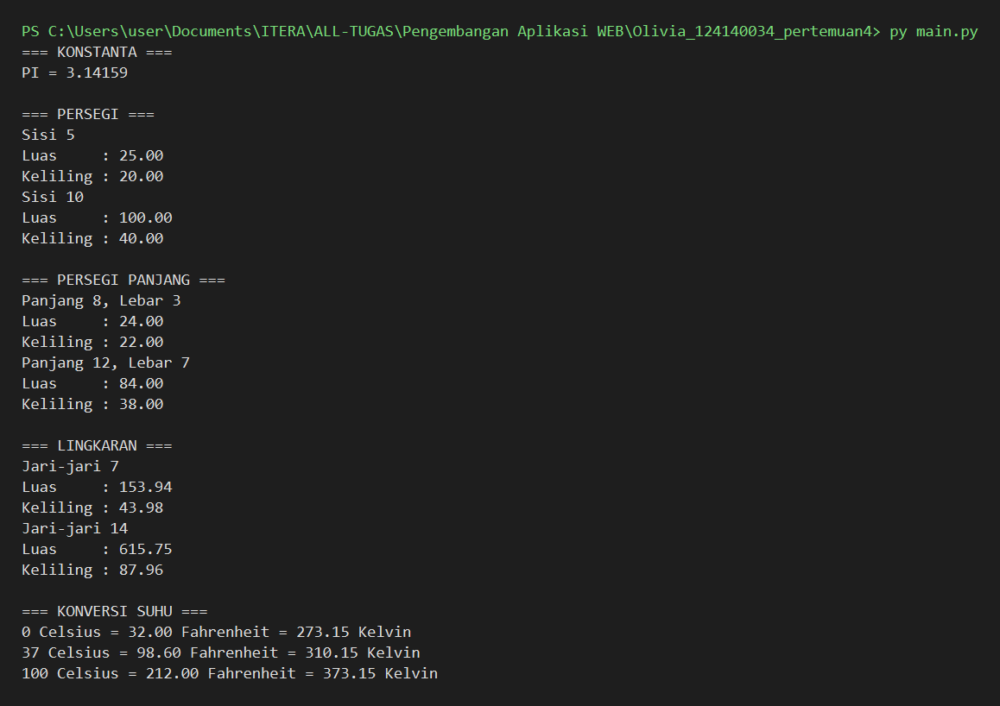

# Tugas Praktikum Pertemuan 4 - Dasar Pemrograman Python

**Nama:** Olivia
**NIM:** 124140034

## Deskripsi Program

### 1. `tugas1_bmi.py`
Meminta input berat (kg) dan tinggi (m), menghitung BMI dengan rumus
`berat / (tinggi * tinggi)`, lalu menentukan kategori memakai `if-elif-else`
(kurang, normal, berlebih, obesitas). Hasil dicetak dengan 2 angka desimal.

### 2. `tugas2_nilai_mahasiswa.py`
Menyimpan 5 data mahasiswa dalam list of dictionary. Fungsi `hitung_nilai_akhir()`
menghitung nilai akhir (30% UTS + 40% UAS + 30% Tugas) dan `tentukan_grade()`
menentukan grade A-E. Data ditampilkan dalam tabel, lalu dicari mahasiswa dengan
nilai akhir tertinggi dan terendah.

### 3. `math_operations.py` dan `main.py`
`math_operations.py` adalah modul berisi konstanta `PI`, fungsi luas & keliling
(persegi, persegi panjang, lingkaran), serta konversi suhu (Celsius ke Fahrenheit
dan Kelvin). `main.py` mengimpor modul tersebut dengan tiga cara
(`import`, `from ... import`, dan `import ... as`) dan memakai semua fungsinya.

## Cara Menjalankan

```bash
python tugas1_bmi.py
python tugas2_nilai_mahasiswa.py
python main.py
```

## Screenshot Hasil Eksekusi

### Soal 1 - `python tugas1_bmi.py`



Output teks:

```
--- PROGRAM PENGHITUNG BMI ---
Masukkan berat badan (kg): 60
Masukkan tinggi badan (m): 1.65

--- HASIL ---
Berat badan  : 60.0 kg
Tinggi badan : 1.65 m
Nilai BMI    : 22.04
Kategori     : Berat badan normal
```

### Soal 2 - `python tugas2_nilai_mahasiswa.py`



Output teks:

```
=======================================================
No  Nama        NIM         Nilai Akhir   Grade
=======================================================
1   Olivia      124140034   87.90         A
2   Budi        124140035   75.00         B
3   Siti        124140036   65.00         C
4   Andi        124140037   54.50         D
5   Dewi        124140038   45.00         E
=======================================================

Nilai akhir tertinggi:
Olivia (124140034) - 87.90 - Grade A

Nilai akhir terendah:
Dewi (124140038) - 45.00 - Grade E
```

### Soal 3 - `python main.py`



Output teks:

```
=== KONSTANTA ===
PI = 3.14159

=== PERSEGI ===
Sisi 5
Luas     : 25.00
Keliling : 20.00
Sisi 10
Luas     : 100.00
Keliling : 40.00

=== PERSEGI PANJANG ===
Panjang 8, Lebar 3
Luas     : 24.00
Keliling : 22.00
Panjang 12, Lebar 7
Luas     : 84.00
Keliling : 38.00

=== LINGKARAN ===
Jari-jari 7
Luas     : 153.94
Keliling : 43.98
Jari-jari 14
Luas     : 615.75
Keliling : 87.96

=== KONVERSI SUHU ===
0 Celsius = 32.00 Fahrenheit = 273.15 Kelvin
37 Celsius = 98.60 Fahrenheit = 310.15 Kelvin
100 Celsius = 212.00 Fahrenheit = 373.15 Kelvin
```
