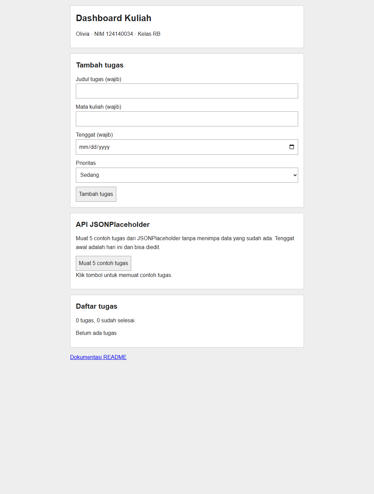

# Dashboard Tugas Kuliah

## Identitas

- Nama: Olivia
- NIM: 124140034
- Kelas: RB
- Pertemuan: 2 — JavaScript Next Gen (ES6+)
- Sumber tugas: https://praktikum-paw20262027.vercel.app/pertemuan/2/tugas-praktikum

## Deskripsi dan fitur

Dashboard ini digunakan untuk mencatat tugas kuliah. Setiap tugas memiliki judul, mata kuliah, tenggat, prioritas, dan status selesai.

Fitur aplikasi:

1. Menambah, mengedit, dan menghapus tugas.
2. Menandai tugas selesai atau belum selesai.
3. Menyimpan data menggunakan `localStorage` agar tetap ada setelah halaman dimuat ulang.
4. Memuat 5 contoh tugas dari API JSONPlaceholder menggunakan `async/await`.
5. Menampilkan jumlah tugas dan jumlah yang sudah selesai.

Tampilan dibuat satu kolom agar sederhana dan tetap bisa digunakan di ponsel. Filter, jam berjalan, statistik terpisah, dan progres bar dari versi sebelumnya dihapus karena bukan fitur wajib. Format data dan key penyimpanan tetap sama sehingga tugas lama masih dapat dibaca.

## Menjalankan aplikasi

Aplikasi memakai ES Modules, jadi jalankan melalui server lokal, bukan klik dua kali `index.html`.

- **Live Server:** buka `index.html` menggunakan ekstensi Live Server di editor yang mendukungnya, misalnya VS Code.
- **Jika Python tersedia:** buka terminal di folder ini, lalu jalankan:

```sh
python -m http.server 5500 --bind 127.0.0.1
```

Buka http://127.0.0.1:5500/. Gunakan `python3` jika itu nama executable Python di perangkat. Hentikan server dengan `Ctrl+C`.

Gunakan browser modern melalui `localhost`, `127.0.0.1`, atau HTTPS agar `crypto.randomUUID()` tersedia.

## Cara penggunaan

1. Isi formulir dan klik **Tambah tugas**.
2. Klik **Edit** pada tugas, ubah isian, lalu klik **Simpan perubahan**. Tombol **Batal edit** membatalkan perubahan formulir.
3. Centang kotak pada tugas untuk mengubah status penyelesaian.
4. Klik **Hapus**, lalu konfirmasi untuk menghapus tugas.
5. Klik **Muat 5 contoh tugas** untuk mengambil data dari JSONPlaceholder.

Data contoh tidak dimuat otomatis dan tidak menimpa tugas yang sudah ada. Memuat ulang contoh tidak menggandakan tugas yang masih ada atau menimpa hasil editnya. Contoh yang dihapus dapat dimuat lagi.

JSONPlaceholder tidak menyediakan mata kuliah dan tenggat. Nilai awal yang digunakan adalah **Tugas Simulasi**, tenggat **hari ini**, dan prioritas **sedang**. Semuanya bisa diedit.

## Screenshot

Gambar berikut diambil dari aplikasi yang berjalan di Chrome, sebelum tugas ditambahkan.



## Implementasi ES6+

Nomor baris menunjukkan awal bagian kode pada versi ini.

| Kriteria | File dan baris | Penggunaan |
| --- | --- | --- |
| `const` | `js/app.js:3` | Deklarasi fungsi dan nilai yang tidak di-assign ulang. |
| `let` | `js/app.js:172` | Ringkasan berubah sesuai jumlah tugas. |
| Arrow function 1 | `js/app.js:3` | `getElement()` memilih elemen HTML. |
| Arrow function 2 | `js/app.js:5` | `formatDate()` menampilkan tanggal. |
| Arrow function 3 | `js/app.js:10` | `createSampleTask()` mengubah data API menjadi tugas. |
| Template literals | `js/app.js:186` | Membuat tampilan kartu tugas dari data. |
| `async`/`await` dan `fetch` | `js/app.js:205` | `loadSampleTasks()` mengambil data JSONPlaceholder. |
| Classes | `js/models.js:22`; `js/app.js:24` | `TaskItem` mewakili tugas, `DashboardApp` mengelola aplikasi. |
| Destructuring parameter | `js/app.js:10,129`; `js/models.js:23` | Membaca properti data tugas dan aksi pengguna. |
| Spread operator | `js/app.js:120,239`; `js/models.js:66` | Memperbarui array atau objek tanpa mengubah data lama. |
| Modules | `js/app.js:1`; `index.html:9` | Menghubungkan `app.js` dan `models.js` dengan import/export. |

## Cara membaca kode

- **`index.html`** berisi formulir, tombol API, dan tempat menampilkan tugas.
- **`style.css`** mengatur warna, jarak, dan ukuran elemen.
- **`js/models.js`** berisi `TaskItem` untuk memeriksa dan menyimpan satu objek tugas, serta fungsi bantu tanggal dan teks aman.
- **`js/app.js`** berisi `DashboardApp`: `loadTasks()` membaca penyimpanan, `submitTask()` memproses formulir, `handleAction()` menangani edit/status/hapus, `updateTasks()` menyimpan perubahan, dan `render()` menampilkan daftar.
- **`tests.html` dan `js/tests.js`** khusus pengujian, tidak dijalankan oleh halaman utama.

Alur utamanya: **isi formulir → buat/perbarui TaskItem → simpan ke localStorage → tampilkan ulang daftar**.

## Penyimpanan dan API

Key penyimpanan adalah `olivia.dashboard.tasks.v1`. Data hanya tersimpan pada browser dan origin yang sama. Menghapus data situs akan menghapus tugas. Tidak ada sinkronisasi antartab atau antarperangkat.

Jika penyimpanan gagal, aplikasi memberi pesan bahwa perubahan belum tersimpan. Jika data lama rusak, aplikasi tidak menimpanya dan hanya menggunakan memori untuk sesi tersebut. Salin atau pulihkan data dari DevTools → Application → Local Storage sebelum menghapus key yang rusak dan memuat ulang halaman.

Satu-satunya API yang digunakan:

```text
https://jsonplaceholder.typicode.com/todos?_limit=5
```

API tidak membutuhkan key. Aplikasi hanya mengambil data dengan `GET`; tugas pengguna tidak dikirim ke API. Permintaan tetap mengirim metadata jaringan standar. Memuat contoh memerlukan internet dan dibatasi 10 detik. Jika gagal, tugas yang sudah ada tidak berubah dan input manual tetap bisa digunakan selama halaman tersedia. Tidak ada service worker untuk menjamin pemuatan halaman offline.

## Pengujian

Buka `tests.html` dari server lokal yang sama, tutup tab dashboard lain, dan tunggu sampai selesai. Tes memakai penyimpanan sementara lalu memulihkan nilai awal; jangan tutup halaman saat tes masih berjalan.

Versi sederhana ini lulus **19/19 pengujian di Chrome headless**, mencakup validasi, CRUD, status selesai, reload data, keamanan teks, loading dan kegagalan API, deduplikasi, data lokal rusak, serta layout pada lebar 320, 390, 768, dan 1440 piksel. Respons API pada tes menggunakan mock. Tes otomatis dijalankan dari file lokal dengan flag `--allow-file-access-from-files`; penggunaan normal tetap melalui HTTP.

Diagnostics editor tidak melaporkan error atau warning.

## Pengumpulan

Simpan folder `Olivia_124140034_pertemuan2` di repository `pemrograman_web_itera_124140034`, lalu kirim tautannya melalui formulir kelas RB sesuai [format pengumpulan](https://praktikum-paw20262027.vercel.app/pertemuan/2/format-pengumpulan).

Deadline pada modul: **Sabtu, 17 Oktober 2026, pukul 23.59 WIB**. Push repository dan pengiriman formulir belum dilakukan.
